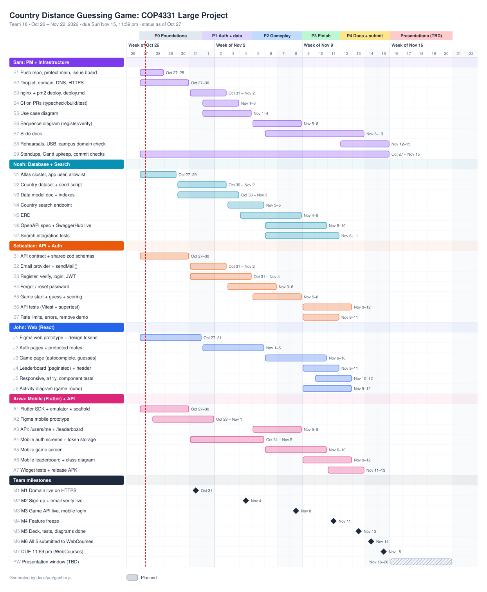
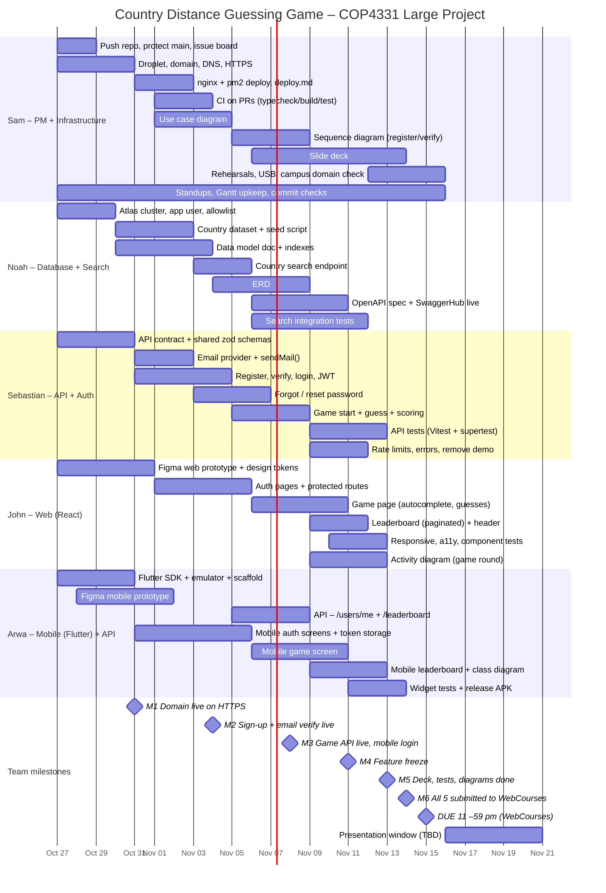

<!-- Generated by docs/pm/gantt.mjs. Edit that file and re-run it, not this one. -->
# Gantt chart

Status as of **Oct 27, 2026**. Regenerate after edits with `node docs/pm/gantt.mjs`.

> **Deadline:** Sun Nov 15, 11:59 pm on WebCourses. Features freeze Wed Nov 11, the deck and docs are done Fri Nov 13, and
> all five submissions go in Sat Nov 14, which leaves Sunday as the only buffer day. Presentation slots aren't
> assigned yet. Once ours is known, update `PW` and the last phase in `gantt.mjs`.

## Task table

| ID | Task | Owner | Start | End | Days | Depends on | Done |
|---|---|---|---|---|---|---|---|
| S1 | Push repo, protect main, issue board | Sam | Oct 27 | Oct 28 | 2 | – | 0% |
| S2 | Droplet, domain, DNS, HTTPS | Sam | Oct 27 | Oct 30 | 4 | – | 0% |
| S3 | nginx + pm2 deploy, deploy.md | Sam | Oct 31 | Nov 2 | 3 | S2 | 0% |
| S4 | CI on PRs (typecheck/build/test) | Sam | Nov 1 | Nov 3 | 3 | S1 | 0% |
| S5 | Use case diagram | Sam | Nov 1 | Nov 4 | 4 | – | 0% |
| S6 | Sequence diagram (register/verify) | Sam | Nov 5 | Nov 8 | 4 | B3 | 0% |
| S7 | Slide deck | Sam | Nov 6 | Nov 13 | 8 | – | 0% |
| S8 | Rehearsals, USB, campus domain check | Sam | Nov 12 | Nov 15 | 4 | M4 | 0% |
| S9 | Standups, Gantt upkeep, commit checks | Sam | Oct 27 | Nov 15 | 20 | – | 0% |
| N1 | Atlas cluster, app user, allowlist | Noah | Oct 27 | Oct 29 | 3 | – | 0% |
| N2 | Country dataset + seed script | Noah | Oct 30 | Nov 2 | 4 | N1 | 0% |
| N3 | Data model doc + indexes | Noah | Oct 30 | Nov 3 | 5 | N1 | 0% |
| N4 | Country search endpoint | Noah | Nov 3 | Nov 5 | 3 | N2 | 0% |
| N5 | ERD | Noah | Nov 4 | Nov 8 | 5 | N3 | 0% |
| N6 | OpenAPI spec + SwaggerHub live | Noah | Nov 6 | Nov 10 | 5 | N4 | 0% |
| N7 | Search integration tests | Noah | Nov 6 | Nov 11 | 6 | N4 | 0% |
| B1 | API contract + shared zod schemas | Sebastian | Oct 27 | Oct 30 | 4 | – | 0% |
| B2 | Email provider + sendMail() | Sebastian | Oct 31 | Nov 2 | 3 | S2 | 0% |
| B3 | Register, verify, login, JWT | Sebastian | Oct 31 | Nov 4 | 5 | B1, N1 | 0% |
| B4 | Forgot / reset password | Sebastian | Nov 3 | Nov 6 | 4 | B2 | 0% |
| B5 | Game start + guess + scoring | Sebastian | Nov 5 | Nov 8 | 4 | B3, N2 | 0% |
| B6 | API tests (Vitest + supertest) | Sebastian | Nov 9 | Nov 12 | 4 | B5 | 0% |
| B7 | Rate limits, errors, remove demo | Sebastian | Nov 9 | Nov 11 | 3 | – | 0% |
| J1 | Figma web prototype + design tokens | John | Oct 27 | Oct 31 | 5 | – | 0% |
| J2 | Auth pages + protected routes | John | Nov 1 | Nov 5 | 5 | B1, J1 | 0% |
| J3 | Game page (autocomplete, guesses) | John | Nov 6 | Nov 10 | 5 | J2, N4 | 0% |
| J4 | Leaderboard (paginated) + header | John | Nov 9 | Nov 11 | 3 | A3 | 0% |
| J5 | Responsive, a11y, component tests | John | Nov 10 | Nov 12 | 3 | – | 0% |
| J6 | Activity diagram (game round) | John | Nov 9 | Nov 12 | 4 | – | 0% |
| A1 | Flutter SDK + emulator + scaffold | Arwa | Oct 27 | Oct 30 | 4 | – | 0% |
| A2 | Figma mobile prototype | Arwa | Oct 28 | Nov 1 | 5 | – | 0% |
| A3 | API: /users/me + /leaderboard | Arwa | Nov 5 | Nov 8 | 4 | B3, N3 | 0% |
| A4 | Mobile auth screens + token storage | Arwa | Oct 31 | Nov 5 | 6 | A1, B1 | 0% |
| A5 | Mobile game screen | Arwa | Nov 6 | Nov 10 | 5 | A4, N4 | 0% |
| A6 | Mobile leaderboard + class diagram | Arwa | Nov 9 | Nov 12 | 4 | A3 | 0% |
| A7 | Widget tests + release APK | Arwa | Nov 11 | Nov 13 | 3 | A5 | 0% |
| M1 | M1 Domain live on HTTPS | Team milestones | Oct 31 | Oct 31 | 1 | S2 | ◆ |
| M2 | M2 Sign-up + email verify live | Team milestones | Nov 4 | Nov 4 | 1 | B2, B3 | ◆ |
| M3 | M3 Game API live, mobile login | Team milestones | Nov 8 | Nov 8 | 1 | B5, N4, A4 | ◆ |
| M4 | M4 Feature freeze | Team milestones | Nov 11 | Nov 11 | 1 | J3, J4, A5 | ◆ |
| M5 | M5 Deck, tests, diagrams done | Team milestones | Nov 13 | Nov 13 | 1 | S7, A7 | ◆ |
| M6 | M6 All 5 submitted to WebCourses | Team milestones | Nov 14 | Nov 14 | 1 | – | ◆ |
| M7 | DUE 11:59 pm (WebCourses) | Team milestones | Nov 15 | Nov 15 | 1 | – | ◆ |
| PW | Presentation window (TBD) | Team milestones | Nov 16 | Nov 20 | 5 | – | 0% |

## Critical path

Atlas (N1) → countries seeded (N2) → search (N4) → web and mobile game screens (J3, A5) → feature freeze (M4).
Game logic (B5) runs alongside. The screens build against the agreed contract and wire up guesses once B5 lands on Nov 8.
Domain + HTTPS (S2) gates email sending (B2), which gates live verification (M2). A slip on any of these moves the freeze, so raise it at standup the day it happens.
